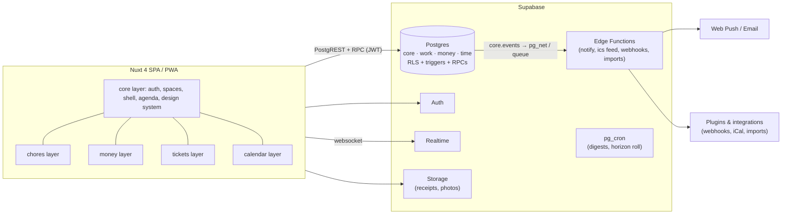
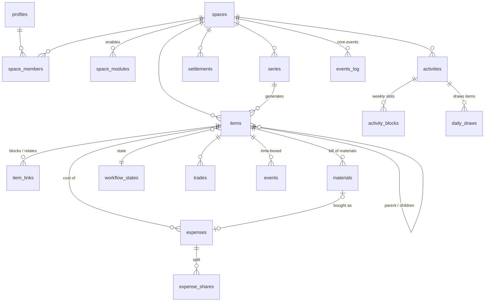

# 03 · System design

Companion artifacts, all validated:
[`reference/schema.sql`](./reference/schema.sql) (target DDL, applies to Postgres; check with `docs/reference/check.sh`) ·
[`reference/types.ts`](./reference/types.ts) (domain types, `tsc --strict` clean) ·
[`reference/algorithms.ts`](./reference/algorithms.ts) (split, balances, simplify, daily draw, conflicts; tested in `tests/algorithms.test.ts`).

## 1. Architecture at a glance



**Decisions and why**

| Decision | Choice | Rationale |
|---|---|---|
| Rendering | SPA (`ssr: false`), static hosting, PWA | Everything sits behind login and RLS does the authorising, so SSR buys nothing. Static hosting is free and simple. A PWA covers mobile install and push. |
| Backend | Supabase (Postgres + Auth + Realtime + Storage + Edge) | Already used by contabilify. RLS turns authorisation into data. One vendor, generous free tier, self-hostable. |
| Business logic | **In Postgres** for invariants (generation, trades, balances); **in TS** for presentation and previews | Atomicity and one source of truth. Duplicated logic (recurrence) is pinned by a parity fixture. |
| Modularity | **Nuxt layers** (UI) + **Postgres schemas** (data) per module, in a pnpm monorepo | Compile-time modules: independent folders, tests and ownership, one deploy. |
| IDs | UUID v4 + per-space sequential `number` for humans (`HOME-42`) | Safe to expose, mergeable. Humans get short keys. |
| Money | Integer minor units + ISO currency + fx_rate snapshot | Exact splitting, no float drift. |
| Time | Local calendar dates + optional wall time for items. `timestamptz` for events | Chores are "Thursday", not an instant. Meetings are instants. |

## 2. Repository layout (target)

```
mise/                         (monorepo, pnpm workspaces)
├─ apps/web/                  Nuxt app: extends the layers it ships with
├─ layers/core/               auth, spaces, members, invites, shell, agenda, i18n, design tokens
├─ layers/chores/             ← today's chore-tracker app, minus what moved to core
├─ layers/money/              expenses, splits, balances, settle; accounts (from contabilify)
├─ layers/tickets/            issues, workflows, boards, materials, assets
├─ layers/calendar/           calendars, events, activities, pools, term planner (from schedules)
├─ packages/domain/           pure TS: dates, recurrence, split, simplify, draw, conflicts (+ tests)
├─ packages/db-types/         generated Supabase types
├─ supabase/migrations/       ordered, one folder per schema: core/, work/, money/, time/
└─ supabase/tests/            SQL suites per module + parity fixtures
```

A module layer contains `pages/`, `components/`, `composables/`, a
`module.manifest.ts` ([`ModuleManifest`](./reference/types.ts)) and its
migrations. The core reads every manifest at build time to assemble the
navigation, settings pages, agenda sections and item-detail slots.

## 3. Data model



### 3.1 The unified *item*

One table (`work.items`) for task, chore occurrence, issue, purchase and note.
They differ by **workflow** and by **which optional fields they use**:

| Kind | Typical workflow | Uses |
|---|---|---|
| `task` | Simple (To do → Done) | due, assignee, priority |
| `chore` | Simple | `series_id`, effort, rotation, trades |
| `issue` | Repair (Reported → Diagnosing → Parts needed → Deferred → In progress → Resolved) | body (symptoms/diagnosis), `next_action`, materials, asset, children, estimated vs actual cost |
| `purchase` | Purchase (Wanted → Researching → Ready to buy → Bought) | estimated cost, url, children ("what I'll do with the drill"), → expense when bought |
| `note` | none | body only; a parent for grouping |

Why one table: hierarchy, dependencies, boards, tags, agenda, search and
trades work identically for every kind, and modules add *behaviour*, not
*silos*. The chores migration already uses this shape (`tasks` +
`chores`), so the move is a rename plus columns.

`state_category` (backlog/todo/active/waiting/done/cancelled) is stored
alongside the custom `state_id`, so cross-module queries ("everything open",
"done this week") never need to know a workflow.

### 3.2 Relative priority

Two complementary mechanisms:
- `priority` 0–4 (none, low, medium, high, urgent) for coarse triage and filters.
- `rank` (fractional index string, LexoRank-style) for **relative order**
  within any list or board column. Drag an item between two others and only
  that row changes. Agenda sorting: overdue first, then rank within priority.

### 3.3 Dependencies and hand-offs (the toilet-seal example)

```
HOME-12 Fix loose toilet seal            issue · Repair · state: Parts needed
├─ HOME-13 Buy sanitary silicone          purchase · assignee: anyone · est €6
└─ HOME-14 Re-seal the toilet             task · assignee: Carol · blocked by HOME-13
```

- `item_links(type='blocks')`: an item is **actionable** iff every item that
  blocks it is done/cancelled. Blocked items show in a "Waiting on…" section,
  never in the agenda.
- Unblocking emits `item.unblocked` → a notification to the assignee ("Silicone
  bought, HOME-14 is ready for you").
- Completing a `purchase` asks "how much?" and creates a `money.expenses` row
  linked to the item (and to the material, if any), pre-split with the
  space's default split. The parent issue's **actual cost** = the sum of
  expenses on it and its descendants.
- A parent can auto-advance: when all children are done, the issue moves to
  the first `done`-category state, if the space enables that.

### 3.4 Recurrence (series)

`work.series` generalises today's `chores` table: a template plus a rule plus
an assignment strategy. Three modes:

| Mode | Behaviour | Example |
|---|---|---|
| `fixed` | Occurrences on calendar dates, materialised to a horizon (42 days) | Trash Mon + Thu |
| `after_completion` | One open occurrence; the next is due one period after the previous closed | Haircut every 5 weeks |
| `pool` | No dates. Members of an activity pool get drawn into the agenda (§3.6) | Tidy desk, sweep room |

The engine (already in production in the chores migration) is idempotent,
re-plans untouched future occurrences on edit, preserves `detached` ones, and
uses the client's local date. Rotation is indexed by occurrence number so
it's deterministic. Members who are **away** (`space_members.away_*`) are
skipped by rotation and balancing during their absence (roadmap item).

### 3.5 Money

```
expense (paid_by, amount, currency, fx_rate, split_method, item_id?)
  └─ expense_shares (user|contact, weight, amount)   Σ amount = expense.amount
settlement (from → to, amount)                         "I paid Bob back"
balances view = Σ paid − Σ owed ± settlements          per user per space
```

- **Splitting** (`splitAmount`): equal / shares / percent / exact. Rounding
  remainders go out one cent at a time, deterministically, so totals always match.
- **"Who's paying?"** UX: *Me*, *Someone else*, *Split equally among…*
  (pick members), *Split by shares/percent/exact*, *Fully theirs* (single
  share for another member: "they owe me all of it").
- **Two views of debt:**
  - *Pairwise* (`pairwiseDebts`): what each person owes each other person,
    from the actual expenses. Default for transparency.
  - *Simplified* (`simplifyDebts`): net balances matched greedily, at most
    n−1 transfers. Your example: me→A €5, A→B €5 becomes **me→B €5**, and A
    is out of it. Shown on a **Settle up** screen. The space setting
    `money.simplify_debts` makes it the default.
- Settling records `money.settlements` (optionally confirmed by the receiver).
  Nothing is ever deleted, so history stays auditable.
- Multi-currency: each expense stores its currency and an fx snapshot to the
  space currency. Balances are computed in the space currency.
- **Accounts** (contabilify): `money.accounts` + `money.transactions` for
  people who also want real balances. An expense can link to the transaction
  that paid it. Contabilify's recurring fee/interest engine ports into
  `money` as a series target.

### 3.6 Time: calendar, activities and pools

- `time.events`: one-off or RRULE events (timestamptz), optional `item_id` for
  time-boxing a task ("Sat 10:00–12:00: fix the door").
- `time.activities` + `activity_blocks`: weekly commitments (courses, gym,
  "Upkeep 19:00–19:30") with optional term dates. `candidate = true` brings
  the **schedules** repo's planner: list candidate courses, see conflicts,
  enumerate compatible sets (`compatibleSets`), then promote one set to real
  activities.
- **Pools:** an activity with `draws_per_day = k` and a pool (a tag, or a
  parent item whose children are the pool). Each day it's scheduled,
  `drawDaily` picks *k* eligible items, weighted by priority and staleness
  and respecting each item's `cooldown_days`. The picks are seeded by
  (user, date) so they're stable, and persisted in `daily_draws` so they're
  auditable. The user can *reroll* or *skip*. Completing a drawn item updates
  its `last done`, which lowers its future weight.
- **Agenda** (`AgendaEntry`): the core's "My day" merges items due or overdue,
  unblocked hand-offs, today's draws, today's events and activity blocks, and
  money nudges ("You owe Bob €12. Settle?"). Each module contributes a
  provider. The core sorts and renders.

## 4. API surface

| Layer | Used for | Examples |
|---|---|---|
| PostgREST (tables/views) | Plain CRUD under RLS | `items`, `expenses`, `events`, `balances` |
| RPC (security definer, membership-checked) | Multi-row invariants | `create_space`, `accept_invite`, `propose_trade`, `respond_trade`, `complete_purchase(item, amount, split)`, `settle_up(space)`, `draw_today(activity, date)`, `promote_candidate_set(...)` |
| Edge Functions | Anything needing secrets or the outside world | push/email delivery, iCal feed (`/ics/:token`), webhooks to plugins, CSV/Splitwise import, receipt OCR |
| Realtime | Live refresh | `items`, `trades`, `expenses`, `settlements` |
| Public REST API (later) | Plugins and automation | Personal access tokens scoped by space and permission; same RLS. |

Error contract: RPCs raise SQLSTATE codes (`42501` forbidden, `22023` invalid,
`P0002` not found, `23505` conflict, `40001` stale). The client maps them to
human messages.

## 5. Security and privacy

- **RLS on every table.** Rule of thumb: member of the row's space ⇒ access.
  Child tables check via their parent. `private` items are restricted to
  creator and assignee (restrictive policy).
- **Composite FKs** `(id, space_id)` on cross-table references (contabilify's
  pattern), so a row can't reference another tenant's data.
- **Privileged writes only through RPCs**: membership, trades, settlements,
  role changes.
- **Server-owned columns** (generator bookkeeping, `number`, `state_category`)
  are protected by triggers.
- **Guests** (`role = guest`): read and complete what's assigned to them, for
  a cleaner or a landlord.
- **Tokens:** invites are 128-bit, expiring and revocable. iCal tokens are
  per-user and rotatable.
- **GDPR:** export everything for a user (JSON + CSV), delete account (profile
  cascade, history anonymised via `on delete set null`), EU region hosting.
- **Tests:** an SQL test suite per module asserting each policy from an
  outsider's point of view (already in place for chores).

## 6. Events, notifications, automation

1. Triggers write `core.events` (today's `activity` table, generalised with `module_id`).
2. A dispatcher (pg_net → Edge Function, or a `pg_cron` sweep) fans events out to:
   - `core.notifications` by per-user preferences: instant push for *trade
     requests, hand-offs, mentions*; a **daily digest** email or push for "your
     day" at the user's chosen time; nothing for noise.
   - Webhooks for plugins subscribed to the verb.
3. Automation rules (later): "when `item.completed` in Trash and the material
   `bin bags` is below 2 → create a purchase", expressed as event → condition
   → action, stored per space.

## 7. Client architecture

- **State:** per-module composables over `useState` (current pattern), with a
  thin cache keyed by id and realtime-triggered refetch. Move to Pinia
  Colada / TanStack Query once offline support lands.
- **Offline / PWA:** service worker cache for the shell. Queued mutations in
  IndexedDB, replayed on reconnect. Last-write-wins per field, except
  completions and trades, which go through RPCs and can be rejected.
- **i18n:** `@nuxtjs/i18n` with en/es/pt from the start of the core layer.
  Dates via `Intl`.
- **Design system:** CSS tokens (already in `main.css`) moved to the core
  layer. Components stay unstyled-library-free for now. Adopting Reka UI
  (formerly radix-vue, used by contabilify via shadcn) for accessible primitives
  is reasonable once dialogs and menus multiply.

## 8. Plugin architecture

| Stage | Who | Mechanism | Trust |
|---|---|---|---|
| 1 · Modules | First party | Nuxt layer + migrations, in the monorepo, toggled per space via `space_modules` | Full |
| 2 · Templates | Anyone | JSON packs: workflows, series, boards, activities ("Moving house", "New flat starter", "Bike maintenance") | Data only |
| 3 · Integrations | Anyone | Manifest + OAuth-style scoped token + webhooks + REST. UI via iframe in declared slots, using a `postMessage` bridge | Sandboxed |

The manifest ([`ModuleManifest`](./reference/types.ts)) declares the routes, item kinds,
slots (`item.sidebar`, `agenda.section`, `space.dashboard`…), event
subscriptions and permissions. The owner approves permissions when enabling
it for a space. That's enough for useful third-party things (a plant-watering
sensor that creates tasks, a bank-import connector, a Home Assistant bridge)
without letting foreign code near the database.

## 9. Deployment and operations

- Static SPA on Vercel / Cloudflare Pages. Supabase project in an EU region.
  `vercel.json` cron (or `pg_cron`) for keep-alive and the digest sweep.
- Environments: local (Supabase CLI), preview (branch DB via Supabase
  branching), prod.
- CI: typecheck → unit → SQL suites on a throwaway Postgres (exists) →
  build → Playwright smoke (exists) → migrations applied on merge.
- Observability: Supabase logs, a `core.events` dashboard, Sentry on the client.
- Backups: Supabase daily backups + weekly logical dump to object storage.

## 10. Migration path from today's schemas

| Step | From | To | How |
|---|---|---|---|
| 1 | `public.spaces/space_members/space_invites/profiles/activity` | `core.*` | `alter table … set schema core`, rename `activity` → `events`, add `module_id='chores'`. Compatibility views in `public` for one release. |
| 2 | `public.chores` + `public.tasks` | `work.series` + `work.items` | `chores` → `series` (fields map 1:1, title etc. into `template`), `tasks` → `items` (`kind='chore'` when `chore_id` is set, else `task`). Add `number`, `rank`, `state_category`. Generator functions retargeted. Parity tests unchanged. |
| 3 | `task_trades` | `work.trades` | Rename. |
| 4 | contabilify `ledgers/cuentas/movimientos` | `core.spaces(kind=organization)` + `money.accounts/transactions` | ETL script per ledger. Amounts × 100 → cents. Spanish columns mapped. Contabilify reads through views until it's retired. |
| 5 | schedules `localStorage` JSON | `time.activities` (+ blocks, `candidate`) | One-click import page: paste or upload the JSON exported from the old app. |
