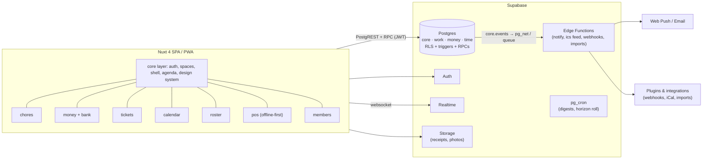
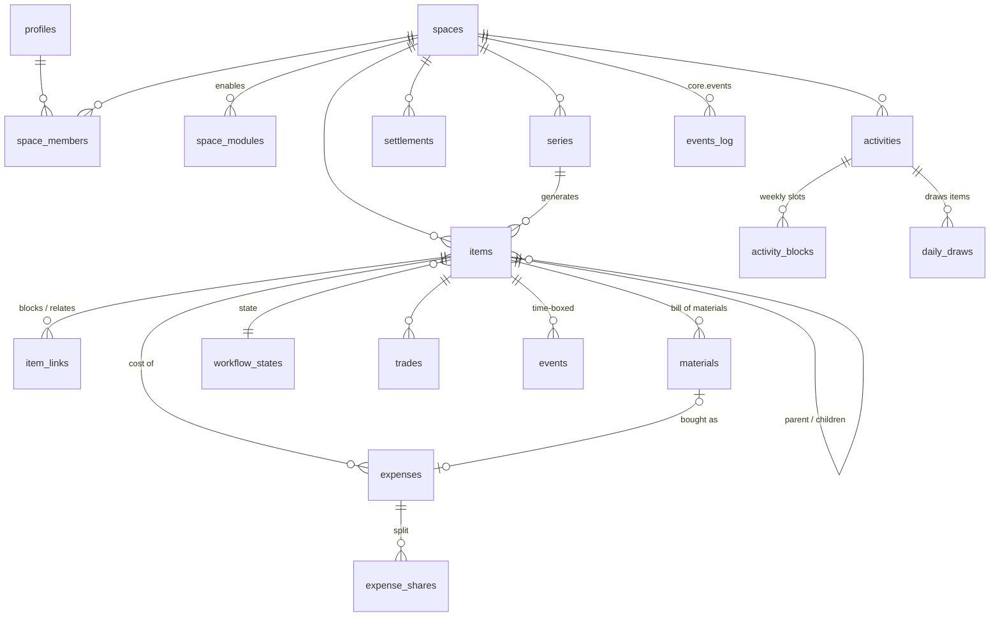

# 03 · System design

Companion artifacts, all validated:
[`reference/schema.sql`](./reference/schema.sql) (target DDL, applies to Postgres; check with `docs/reference/check.sh`) ·
[`reference/types.ts`](./reference/types.ts) (domain types, `tsc --strict` clean) ·
[`reference/algorithms.ts`](./reference/algorithms.ts) (split, balances, simplify, daily draw, conflicts; tested in `tests/algorithms.test.ts`) ·
[`reference/rostering.ts`](./reference/rostering.ts) (selectors, staffing rules, fair fill, constrained trades; tested in `tests/rostering.test.ts`).

## 1. Architecture at a glance



**Decisions and why**

| Decision | Choice | Rationale |
|---|---|---|
| Rendering | SPA (`ssr: false`), static hosting, PWA | Everything sits behind login and RLS does the authorising, so SSR buys nothing. Static hosting is free and simple. A PWA covers mobile install and push. |
| Backend | Supabase (Postgres + Auth + Realtime + Storage + Edge) | Already used by contabilify. RLS turns authorisation into data. One vendor, generous free tier, self-hostable. |
| Business logic | **In Postgres** for invariants (generation, trades, balances); **in TS** for presentation and previews | Atomicity and one source of truth. Duplicated logic (recurrence) is pinned by a parity fixture. |
| Modularity | **Nuxt layers** (UI) + **Postgres schemas** (data) per module, in a pnpm monorepo | Compile-time modules: independent folders, tests and ownership, one deploy. |
| IDs | UUID v4 + per-space sequential `number` for humans (`HOME-42`) | Safe to expose, mergeable. Humans get short keys. |
| Money | Integer minor units + ISO currency + fx_rate snapshot | Exact splitting, no float drift. |
| Time | Local calendar dates + optional wall time for items. `timestamptz` for events | Chores are "Thursday", not an instant. Meetings are instants. |

## 2. Repository layout (target)

```
mise/                         (monorepo, pnpm workspaces)
├─ apps/web/                  Nuxt app: extends the layers it ships with
├─ layers/core/               auth, spaces, members, invites, shell, agenda, i18n, design tokens
├─ layers/chores/             ← today's chore-tracker app, minus what moved to core
├─ layers/money/              expenses, splits, balances, settle; accounts (from contabilify)
├─ layers/tickets/            issues, workflows, boards, materials, assets
├─ layers/calendar/           calendars, events, activities, pools, term planner (from schedules)
├─ layers/roster/             seasons, shift templates, rules, draw/sign-up, availability, attendance
├─ layers/pos/                till UI (PWA, offline), catalogue, stock, sessions, fiscal log
├─ layers/members/            association members, fees, member pricing
├─ supabase/functions/bank/   aggregator adapters (one per provider) + sync + matching
├─ packages/domain/           pure TS: dates, recurrence, split, simplify, draw, conflicts (+ tests)
├─ packages/db-types/         generated Supabase types
├─ supabase/migrations/       ordered, one folder per schema: core/, work/, money/, time/
└─ supabase/tests/            SQL suites per module + parity fixtures
```

A module layer contains `pages/`, `components/`, `composables/`, a
`module.manifest.ts` ([`ModuleManifest`](./reference/types.ts)) and its
migrations. The core reads every manifest at build time to assemble the
navigation, settings pages, agenda sections and item-detail slots.

## 3. Data model



### 3.1 The unified *item*

One table (`work.items`) for task, chore occurrence, issue, purchase and note.
They differ by **workflow** and by **which optional fields they use**:

| Kind | Typical workflow | Uses |
|---|---|---|
| `task` | Simple (To do → Done) | due, assignee, priority |
| `chore` | Simple | `series_id`, effort, rotation, trades |
| `issue` | Repair (Reported → Diagnosing → Parts needed → Deferred → In progress → Resolved) | body (symptoms/diagnosis), `next_action`, materials, asset, children, estimated vs actual cost |
| `purchase` | Purchase (Wanted → Researching → Ready to buy → Bought) | estimated cost, url, children ("what I'll do with the drill"), → expense when bought |
| `note` | none | body only; a parent for grouping |
| `shift` | Shift (Draft → Published → Done / Cancelled) | time window, several seats (`item_assignees`), staffing requirements, attendance, till session (§3.7) |

Why one table: hierarchy, dependencies, boards, tags, agenda, search and
trades work identically for every kind, and modules add *behaviour*, not
*silos*. The chores migration already uses this shape (`tasks` +
`chores`), so the move is a rename plus columns.

`state_category` (backlog/todo/active/waiting/done/cancelled) is stored
alongside the custom `state_id`, so cross-module queries ("everything open",
"done this week") never need to know a workflow.

### 3.2 Relative priority

Two complementary mechanisms:
- `priority` 0–4 (none, low, medium, high, urgent) for coarse triage and filters.
- `rank` (fractional index string, LexoRank-style) for **relative order**
  within any list or board column. Drag an item between two others and only
  that row changes. Agenda sorting: overdue first, then rank within priority.

### 3.3 Dependencies and hand-offs (the toilet-seal example)

```
HOME-12 Fix loose toilet seal            issue · Repair · state: Parts needed
├─ HOME-13 Buy sanitary silicone          purchase · assignee: anyone · est €6
└─ HOME-14 Re-seal the toilet             task · assignee: Carol · blocked by HOME-13
```

- `item_links(type='blocks')`: an item is **actionable** iff every item that
  blocks it is done/cancelled. Blocked items show in a "Waiting on…" section,
  never in the agenda.
- Unblocking emits `item.unblocked` → a notification to the assignee ("Silicone
  bought, HOME-14 is ready for you").
- Completing a `purchase` asks "how much?" and creates a `money.expenses` row
  linked to the item (and to the material, if any), pre-split with the
  space's default split. The parent issue's **actual cost** = the sum of
  expenses on it and its descendants.
- A parent can auto-advance: when all children are done, the issue moves to
  the first `done`-category state, if the space enables that.

### 3.4 Recurrence (series)

`work.series` generalises today's `chores` table: a template plus a rule plus
an assignment strategy. Three modes:

| Mode | Behaviour | Example |
|---|---|---|
| `fixed` | Occurrences on calendar dates, materialised to a horizon (42 days) | Trash Mon + Thu |
| `after_completion` | One open occurrence; the next is due one period after the previous closed | Haircut every 5 weeks |
| `pool` | No dates. Members of an activity pool get drawn into the agenda (§3.6) | Tidy desk, sweep room |

The engine (already in production in the chores migration) is idempotent,
re-plans untouched future occurrences on edit, preserves `detached` ones, and
uses the client's local date. Rotation is indexed by occurrence number so
it's deterministic. Members who are **away** (`space_members.away_*`) are
skipped by rotation and balancing during their absence (roadmap item).

### 3.5 Money

```
expense (paid_by, amount, currency, fx_rate, split_method, item_id?)
  └─ expense_shares (user|contact, weight, amount)   Σ amount = expense.amount
settlement (from → to, amount)                         "I paid Bob back"
balances view = Σ paid − Σ owed ± settlements          per user per space
```

- **Splitting** (`splitAmount`): equal / shares / percent / exact. Rounding
  remainders go out one cent at a time, deterministically, so totals always match.
- **"Who's paying?"** UX: *Me*, *Someone else*, *Split equally among…*
  (pick members), *Split by shares/percent/exact*, *Fully theirs* (single
  share for another member: "they owe me all of it").
- **Two views of debt:**
  - *Pairwise* (`pairwiseDebts`): what each person owes each other person,
    from the actual expenses. Default for transparency.
  - *Simplified* (`simplifyDebts`): net balances matched greedily, at most
    n−1 transfers. Your example: me→A €5, A→B €5 becomes **me→B €5**, and A
    is out of it. Shown on a **Settle up** screen. The space setting
    `money.simplify_debts` makes it the default.
- Settling records `money.settlements` (optionally confirmed by the receiver).
  Nothing is ever deleted, so history stays auditable.
- Multi-currency: each expense stores its currency and an fx snapshot to the
  space currency. Balances are computed in the space currency.
- **Accounts** (contabilify): `money.accounts` + `money.transactions` for
  people who also want real balances. An expense can link to the transaction
  that paid it. Contabilify's recurring fee/interest engine ports into
  `money` as a series target.

### 3.6 Time: calendar, activities and pools

- `time.events`: one-off or RRULE events (timestamptz), optional `item_id` for
  time-boxing a task ("Sat 10:00–12:00: fix the door").
- `time.activities` + `activity_blocks`: weekly commitments (courses, gym,
  "Upkeep 19:00–19:30") with optional term dates. `candidate = true` brings
  the **schedules** repo's planner: list candidate courses, see conflicts,
  enumerate compatible sets (`compatibleSets`), then promote one set to real
  activities.
- **Pools:** an activity with `draws_per_day = k` and a pool (a tag, or a
  parent item whose children are the pool). Each day it's scheduled,
  `drawDaily` picks *k* eligible items, weighted by priority and staleness
  and respecting each item's `cooldown_days`. The picks are seeded by
  (user, date) so they're stable, and persisted in `daily_draws` so they're
  auditable. The user can *reroll* or *skip*. Completing a drawn item updates
  its `last done`, which lowers its future weight.
- **Agenda** (`AgendaEntry`): the core's "My day" merges items due or overdue,
  unblocked hand-offs, today's draws, today's events and activity blocks, and
  money nudges ("You owe Bob €12. Settle?"). Each module contributes a
  provider. The core sorts and renders.

### 3.7 Roster: shifts, staffing rules, fair draws

A shift is an item (`kind = 'shift'`) with a time window and **several
seats** (`work.item_assignees`). Everything else is configuration:

```
season (date range, priority)
 └─ shift_template (weekdays, 18:00–24:00, headcount 2–2, eligible selector, fill mode)
     └─ requirements: [≥1 tag:experienced] [≤1 tag:inexperienced]
policy (horizon, publish lead time, max shifts/week, min rest, fairness window, trades need approval?)
availability (unavailable / prefer / prefer-not, one-off or weekly)
```

**Selectors** are small JSON boolean expressions over member tags and people
(`{"tag":"electrician"}`, `{"anyOf":[…]}`, `{"not":…}`, `{"people":[…]}`).
A **requirement** says how many of a shift's people must match a selector
(min/max). The total headcount is its own min/max, and an `eligible` selector
filters who can work the shift at all. Requirements count *people who match*,
not fixed slots, so overlapping skills work naturally: an experienced
electrician counts toward both "≥1 experienced" and "≥1 electrician". That
expresses both the town bar ("≥1 experienced, ≤1 inexperienced, exactly 2")
and the crew ("≥1 electrician, the rest any of mechanic, electrician,
plumber or HVAC") with no special cases.

**Generation** (same lazy pattern as chores):
1. For each date in the horizon, the highest-priority season covering it
   selects templates. Each matching template creates one `roster.shifts` row +
   item in `draft`.
2. **Fill**, by the template's mode:
   - `draw`: `fillRoster` processes shifts chronologically. Candidates are
     eligible people who are available, not overlapping, within the weekly cap
     and with enough rest. They're ordered by **load** (hours worked in the
     fairness window, plus hours already drawn this run), with a seeded random
     tie-break. A backtracking search picks the first team satisfying every
     rule, preferring the largest allowed headcount. Pruning: no rule over its
     max, and enough remaining matching candidates and seats for every min.
     Team sizes are small (≤ ~10 seats, ≤ ~100 people), so this runs in
     milliseconds. If there's no valid team, the shift is marked
     **understaffed** and coordinators are notified, rather than breaking rules.
   - `signup`: shifts are published empty. People claim seats, and each claim is
     validated (a claim that would make the rules unsatisfiable is refused).
   - `signup_then_draw`: sign-ups first, then the draw fills the remaining
     seats *around* the volunteers (`fixed`) at `signup_closes_hours` before
     the shift.
3. Drafts become **published** `publish_days_ahead` before the date. Publishing
   notifies everyone of their shifts and adds them to their agenda and iCal feed.
4. **Attendance:** check-in/out (button, QR at the venue, or till open/close)
   records actual hours, feeds the fairness load and gives employers the
   time-tracking record that Spanish employment law requires for staff
   (*registro de jornada*). Volunteers get an hours log for their records.

The engine is pure TypeScript (`docs/reference/rostering.ts`), so it can run
client-side for previews ("what would next month look like?") and inside an
Edge Function for the real run. Unlike recurrence, it doesn't need a SQL
twin: shifts are written in one transaction by the function, and validity on
writes is enforced by `validate_assignment()` (§3.8).

### 3.8 Universal trades (and assignment validation)

Trades were chores-only. They become a **core capability for any assignable
item**: chore occurrence, task, issue, purchase, shift seat.

- Each module registers `validate_assignment(item, proposed_assignees) →
  AssignmentCheck`:
  - chores/tasks: assignees are members (+ optional eligibility requirement);
  - tickets: eligibility requirements on the issue ("needs `plumber`");
  - roster: staffing rules of *every affected shift* plus each person's
    availability, overlaps, weekly cap and rest (`validateTrade`).
- **A trade is valid iff the state after the trade introduces no violation
  that didn't exist before.** An already-understaffed shift can still be
  traded in ways that don't make it worse.
- The UI never offers an invalid trade. "Who can take this?" lists only valid
  takers (`validTakers`), and swaps only list counter-items that keep both
  sides valid. Rejections explain the rule that would break.
- Acceptance re-validates inside the RPC transaction (state may have changed),
  exactly like chores' `respond_trade` today.
- Optional **approval** (`trades_need_approval`): an accepted trade waits for an
  admin's OK. Some organisations want this for paid staff.
- Trades are disabled in spaces with a single member (personal spaces).

### 3.9 EPOS

**Goals:** fast at a busy bar, works offline, posts to the books automatically,
legally compliant where it's used.

| Concern | Design |
|---|---|
| **UI** | Separate till route in the PWA: product grid by category, big targets, quick quantity, open tabs, member lookup (member prices), split payment, refund, cash in/out. Pinned to a tablet with a PIN per volunteer (fast user switch, no full login). |
| **Offline-first** | Orders get client-generated UUIDs and are written to IndexedDB first, then synced in order. Numbering is per register, reserved in blocks while online so it stays gapless offline. The catalogue is cached. Sync conflicts are impossible by construction because orders are append-only. |
| **Till sessions** | Open with a float (optionally linked to the current shift). Close by counting cash: expected vs counted, with the difference attributed to the session and shift. Closing posts a summary `money.transactions` row per payment method to the register's cash/card accounts (`source = 'pos'`). |
| **Stock** | Recipes deduct stock per sale. Reorder points create a purchase item (Tickets/Chores) for the people tagged `supplier-runs`. Stocktakes reconcile. |
| **Hardware** | Receipt printing (ESC/POS) via the browser (WebUSB/Web Bluetooth where supported) or a tiny local print bridge. Cash drawer opened through the printer. Card payments start as **"external terminal"** (staff types the amount on the bank's terminal and marks it paid). Later, terminal integrations (SumUp, Stripe Terminal, Redsys) where available. |
| **Fiscal compliance** | A pluggable `fiscal` adapter per jurisdiction. **Spain:** the anti-fraud law's invoicing-software rules (*VERI\*FACTU*) apply from **1 Jan 2027** for corporate-tax payers and **1 Jul 2027** for others (Real Decreto-ley 15/2025). They require a hash-chained, unalterable record of every invoice/ticket, a QR code on tickets, optional real-time submission to the AEAT, and a *declaración responsable* from the software producer. `pos.fiscal_records` holds the chain. Whether a non-profit association falls under it, and from which date, must be confirmed with a tax adviser. Basque and Navarre territories have their own systems (TicketBAI). Options: (a) implement and self-certify, or (b) delegate record-keeping to a certified invoicing API and store its references. (b) is lower-risk to start. |
| **Reporting** | Sales by product, hour and shift; margins via stock unit costs; VAT summary; export for the gestoría. |

### 3.10 Bank feeds

- **Adapter pattern** (`BankAdapter` in `reference/types.ts`): `startConsent`,
  `listAccounts`, `fetchTransactions`, `fetchBalance`. Implemented per
  aggregator in Edge Functions. Nothing provider-specific leaks into the app.
- **Provider choice** (verify current terms before building, because this
  market shifts): Plaid (strongest in US/UK, partial EU), **Tink**, **Salt
  Edge**, **Enable Banking**, TrueLayer, GoCardless Bank Account Data.
  For Spanish and Portuguese banks, pick the provider with the best coverage
  of *your* banks and a plan small organisations can afford. Under PSD2 you
  consume account information *through* a licensed provider. You don't need
  your own licence.
- **Consent lifecycle:** PSD2 consents expire (commonly up to 180 days). Store
  the expiry, warn 14 days ahead, and one-click re-consent. Tokens live in
  Supabase **Vault**, never in tables or the client.
- **Sync:** a scheduled function pulls new transactions (dedupe on
  `(account_id, external_id)`) and stores balances for drift checks.
- **Matching:** each bank transaction is matched against open expenses,
  till-close deposits, member fees and recurring rules by amount ± tolerance,
  date window and counterparty similarity. Confident matches auto-link.
  The rest goes to a review inbox. Reconciliation state per transaction:
  unmatched → suggested → matched (by whom).
- **Read-only**, deliberately. No payment initiation, which keeps the product
  out of payment regulation.

### 3.11 Members (associations)

`core.org_members` is the member register (socios), separate from app users:
most members never log in. Fee plans generate expected income (recurrence
engine), and payments are matched from the bank feed or recorded at the till.
Member pricing is applied at the EPOS by member number or card QR. Exports
cover the assembly report and the register required by association law.

## 4. API surface

| Layer | Used for | Examples |
|---|---|---|
| PostgREST (tables/views) | Plain CRUD under RLS | `items`, `expenses`, `events`, `balances` |
| RPC (security definer, membership-checked) | Multi-row invariants | `create_space`, `accept_invite`, `propose_trade` / `respond_trade` (any item, validated), `claim_seat(shift)`, `publish_roster(space, range)`, `open_till` / `close_till`, `complete_purchase(item, amount, split)`, `settle_up(space)`, `match_bank_tx(tx, target)`, `draw_today(activity, date)` |
| Edge Functions | Anything needing secrets or the outside world, or heavy compute | roster fill runs, bank sync + matching, fiscal submission, push/email delivery, iCal feed (`/ics/:token`), webhooks, imports, receipt OCR |
| Realtime | Live refresh | `items`, `trades`, `expenses`, `settlements` |
| Public REST API (later) | Plugins and automation | Personal access tokens scoped by space and permission; same RLS. |

Error contract: RPCs raise SQLSTATE codes (`42501` forbidden, `22023` invalid,
`P0002` not found, `23505` conflict, `40001` stale). The client maps them to
human messages.

## 5. Security and privacy

- **RLS on every table.** Rule of thumb: member of the row's space ⇒ access.
  Child tables check via their parent. `private` items are restricted to
  creator and assignee (restrictive policy).
- **Composite FKs** `(id, space_id)` on cross-table references (contabilify's
  pattern), so a row can't reference another tenant's data.
- **Privileged writes only through RPCs**: membership, trades, settlements,
  role changes.
- **Server-owned columns** (generator bookkeeping, `number`, `state_category`)
  are protected by triggers.
- **Guests** (`role = guest`): read and complete what's assigned to them, for
  a cleaner or a landlord.
- **Till PINs:** a registered till device holds a device-scoped session.
  Volunteers switch in with a 4–6 digit PIN that maps to their member id and
  is rate-limited. The device can only call `pos.*` RPCs for its register.
- **Money roles:** in organisations, `treasurer` and `coordinator` are tags
  that unlock bank, reconciliation and roster-publishing permissions, so
  permissions follow the same tag model as staffing rules.
- **Tokens:** invites are 128-bit, expiring and revocable. iCal tokens are
  per-user and rotatable.
- **GDPR:** export everything for a user (JSON + CSV), delete account (profile
  cascade, history anonymised via `on delete set null`), EU region hosting.
- **Tests:** an SQL test suite per module asserting each policy from an
  outsider's point of view (already in place for chores).

## 6. Events, notifications, automation

1. Triggers write `core.events` (today's `activity` table, generalised with `module_id`).
2. A dispatcher (pg_net → Edge Function, or a `pg_cron` sweep) fans events out to:
   - `core.notifications` by per-user preferences: instant push for *trade
     requests, hand-offs, mentions*; a **daily digest** email or push for "your
     day" at the user's chosen time; nothing for noise.
   - Webhooks for plugins subscribed to the verb.
3. Automation rules (later): "when `item.completed` in Trash and the material
   `bin bags` is below 2 → create a purchase", expressed as event → condition
   → action, stored per space.

## 7. Client architecture

- **State:** per-module composables over `useState` (current pattern), with a
  thin cache keyed by id and realtime-triggered refetch. Move to Pinia
  Colada / TanStack Query once offline support lands.
- **Offline / PWA:** service worker cache for the shell. Queued mutations in
  IndexedDB, replayed on reconnect. Last-write-wins per field, except
  completions and trades, which go through RPCs and can be rejected.
- **i18n:** `@nuxtjs/i18n` with en/es/pt from the start of the core layer.
  Dates via `Intl`.
- **Design system:** CSS tokens (already in `main.css`) moved to the core
  layer. Components stay unstyled-library-free for now. Adopting Reka UI
  (formerly radix-vue, used by contabilify via shadcn) for accessible primitives
  is reasonable once dialogs and menus multiply.

## 8. Plugin architecture

| Stage | Who | Mechanism | Trust |
|---|---|---|---|
| 1 · Modules | First party | Nuxt layer + migrations, in the monorepo, toggled per space via `space_modules` | Full |
| 2 · Templates | Anyone | JSON packs: workflows, series, boards, activities ("Moving house", "New flat starter", "Bike maintenance") | Data only |
| 3 · Integrations | Anyone | Manifest + OAuth-style scoped token + webhooks + REST. UI via iframe in declared slots, using a `postMessage` bridge | Sandboxed |

The manifest ([`ModuleManifest`](./reference/types.ts)) declares the routes, item kinds,
slots (`item.sidebar`, `agenda.section`, `space.dashboard`…), event
subscriptions and permissions. The owner approves permissions when enabling
it for a space. That's enough for useful third-party things (a plant-watering
sensor that creates tasks, a bank-import connector, a Home Assistant bridge)
without letting foreign code near the database.

## 9. Deployment and operations

- Static SPA on Vercel / Cloudflare Pages. Supabase project in an EU region.
  `vercel.json` cron (or `pg_cron`) for keep-alive and the digest sweep.
- Environments: local (Supabase CLI), preview (branch DB via Supabase
  branching), prod.
- CI: typecheck → unit → SQL suites on a throwaway Postgres (exists) →
  build → Playwright smoke (exists) → migrations applied on merge.
- Observability: Supabase logs, a `core.events` dashboard, Sentry on the client.
- Backups: Supabase daily backups + weekly logical dump to object storage.

## 10. Migration path from today's schemas

| Step | From | To | How |
|---|---|---|---|
| 1 | `public.spaces/space_members/space_invites/profiles/activity` | `core.*` | `alter table … set schema core`, rename `activity` → `events`, add `module_id='chores'`. Compatibility views in `public` for one release. |
| 2 | `public.chores` + `public.tasks` | `work.series` + `work.items` | `chores` → `series` (fields map 1:1, title etc. into `template`), `tasks` → `items` (`kind='chore'` when `chore_id` is set, else `task`). Add `number`, `rank`, `state_category`. Generator functions retargeted. Parity tests unchanged. |
| 3 | `task_trades` | `work.trades` | Rename. |
| 4 | contabilify `ledgers/cuentas/movimientos` | `core.spaces(kind=organization)` + `money.accounts/transactions` | ETL script per ledger. Amounts × 100 → cents. Spanish columns mapped. Contabilify reads through views until it's retired. |
| 5 | schedules `localStorage` JSON | `time.activities` (+ blocks, `candidate`) | One-click import page: paste or upload the JSON exported from the old app. |
