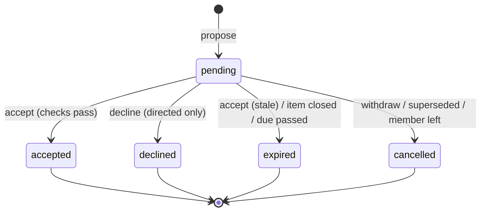

# 04 · Formal specification

Keywords **MUST / SHOULD / MAY** as in RFC 2119. Requirement ids are stable;
reference them in issues and commits. Status: ✅ implemented on this branch ·
🟡 partially · ⬜ planned.

## 1. Glossary

| Term | Definition |
|---|---|
| **User** | An authenticated person with a profile. |
| **Space** | A tenant: `personal` (exactly one per user, single member), `household`, `project`, `organization`. |
| **Member** | (space, user, role). Roles are ordered `guest < member < admin < owner`. |
| **Item** | A unit of work or tracking: task, chore occurrence, issue, purchase, note. |
| **Series** | A recurrence template that generates items (a "chore" in the chores UI). |
| **Occurrence** | An item generated by a series, identified by (series, due date) and an index *n*. |
| **Detached** | An occurrence modified by a human. The generator never alters or deletes it. |
| **Actionable** | Open, not before its start date, and not blocked by an open item. |
| **Trade** | A proposal to move an item's assignee from A to B, optionally swapping a counter-item from B to A. |
| **Expense** | Money paid by one party on behalf of a set of parties, with resolved shares. |
| **Balance** | Σ paid − Σ owed + Σ settlements paid − Σ settlements received, per user per space. |
| **Activity** | A recurring time commitment (weekly blocks) and/or an item pool. |
| **Draw** | Selecting *k* pool items into a user's day. |
| **Today** | The user's local calendar date, as supplied by the client. |
| **Tag** | A label on a member within a space: skill, pool, certification. |
| **Selector** | A boolean expression over tags and people that matches members. |
| **Requirement** | (selector, min?, max?) over the assignees of an item or shift. |
| **Shift** | A time-windowed item with several seats, generated from a template. |
| **Till session** | The period between opening and closing a register, with a cash count. |

## 2. Global invariants

| Id | Invariant |
|---|---|
| INV-1 | Every row with a `space_id` is readable or writable only by members of that space (RLS), except through RPCs that check membership explicitly. |
| INV-2 | A user has exactly one personal space. It has exactly one member and can't be left, shared or deleted while the user exists. |
| INV-3 | Every space has exactly one owner while it has members. A space with zero members is deleted. |
| INV-4 | An item's `assignee_id`, when set, refers to a current member of the item's space. |
| INV-5 | For a series *s* and date *d*, at most one item exists with `(series_id, due_date) = (s, d)`. |
| INV-6 | `status = open ⇔ closed_at is null`. `completed_by` is set only when status = done. |
| INV-7 | At most one *pending* trade references a given item as the offered item. |
| INV-8 | Σ `expense_shares.amount` = `expenses.amount` for every expense (integer cents). |
| INV-9 | Σ balances over a space = 0 (in the space currency, after fx rounding is assigned to the payer). |
| INV-10 | `core.events` is append-only. No update or delete except cascade on space deletion. |
| INV-11 | Generator bookkeeping (`generated_until`, `generated_count`) is writable only by the generator. |
| INV-12 | No item may block itself, transitively. `blocks` links form a DAG. |
| INV-13 | A day's draw for (user, activity, date) never changes once made, except by explicit reroll. |
| INV-14 | No published shift has an assignment violating a hard constraint unless a coordinator overrode it explicitly (logged). Accepting a trade never creates a new violation. |
| INV-15 | POS orders, payments and fiscal records are append-only. Corrections are new records. Fiscal records form an unbroken hash chain per space. |
| INV-16 | Σ payments of a paid order = order total. Σ till-close postings = Σ payments in the session by method. |
| INV-17 | A bank transaction is linked to at most one reconciliation target set, and its external id is unique per account. |

## 3. Requirements

### 3.1 Core — accounts, spaces, membership (CORE)

| Id | Requirement | Status |
|---|---|---|
| CORE-1 | The system MUST support sign-up and sign-in with email + password and passwordless email link. | ✅ |
| CORE-2 | On sign-up the system MUST create a profile and a personal space with the user as owner (INV-2). | ✅ |
| CORE-3 | A user MUST be able to create a household and becomes its owner. | ✅ |
| CORE-4 | Any household member MUST be able to create an invite link. Invites MUST carry ≥ 128 bits of entropy, MUST expire (default 7 days), MAY have a max-use count, and MUST be revocable. | ✅ |
| CORE-5 | A signed-in user opening a valid invite MUST see the space name, description and member count before joining. Invalid invites MUST explain why (not found, revoked, expired, used up). | ✅ |
| CORE-6 | Leaving a space MUST unassign the leaver's open items there, remove them from rotations, re-plan affected series, and cancel their pending trades. If the leaver is the owner, ownership MUST pass to the longest-standing admin, else member. | ✅ |
| CORE-7 | Owners MUST be able to change roles and transfer ownership. Owners and admins MUST be able to remove non-owner members. | ✅ |
| CORE-8 | Only the owner MAY delete a household. Deletion cascades to all its data. | ✅ |
| CORE-9 | Users MUST be able to set display name, avatar, locale, timezone, week start and default currency. | 🟡 name only |
| CORE-10 | Members SHOULD be able to mark themselves *away* for a date range. Rotation and balancing MUST skip away members for occurrences in that range. | ⬜ |
| CORE-11 | Spaces MUST be able to enable or disable modules. Disabled modules' data MUST be hidden, not deleted. | ⬜ |
| CORE-12 | Users MUST be able to export all their data (JSON + CSV) and delete their account (GDPR). | ⬜ |
| CORE-13 | The UI MUST be available in English, Spanish and Portuguese. | ⬜ |

### 3.2 Chores and tasks (CHO)

| Id | Requirement | Status |
|---|---|---|
| CHO-1 | Users MUST be able to create items with title (1–200 chars), optional notes, due date (or none), optional time, priority 0–4, effort 1–5, assignee (member or nobody). | ✅ |
| CHO-2 | A series MUST support frequencies daily/weekly/monthly/yearly with interval *N* ∈ [1, 365], weekly weekday sets, start date, optional end date and optional time. | ✅ |
| CHO-3 | **Occurrence predicate** (fixed mode) MUST be exactly §5.1. Day-of-month and leap-day overflow MUST clamp to the last day of the month. | ✅ |
| CHO-4 | In *after_completion* mode there MUST be exactly one open occurrence. When it closes on date *c*, the next MUST be due on *advance(c)* (§5.2). | ✅ |
| CHO-5 | The generator MUST materialise fixed occurrences in [today, today + H] (H = 42 days) and MUST NOT create occurrences before today. It MUST be idempotent. | ✅ |
| CHO-6 | Assignment MUST follow the series strategy (§5.3): rotation, balanced, fixed, unassigned. | ✅ |
| CHO-7 | Editing any series field MUST regenerate open, non-detached, future occurrences without a pending trade, and MUST leave others untouched. | ✅ |
| CHO-8 | Editing an occurrence's title, notes, date, time, assignee, priority or effort MUST mark it detached. | ✅ |
| CHO-9 | Pausing a series MUST remove its untouched future occurrences. Resuming MUST re-plan them. Deleting MUST remove open untouched occurrences and keep history. | ✅ |
| CHO-10 | Completing MUST record `completed_by` = the actor (which may differ from the assignee). Skipping MUST close without credit. Both MUST be undoable. | ✅ |
| CHO-11 | Unassigned household items MUST be listed as *up for grabs*, and any member MAY claim one atomically (first claim wins). | ✅ |
| CHO-12 | The chore form MUST preview the next 6 occurrences with assignees before saving. | ✅ |
| CHO-13 | Per-member stats MUST show items done and effort in the last 30 days, open assigned and overdue. | ✅ |
| CHO-14 | The agenda MUST group open items into Overdue, Today, Tomorrow, Later this week, Next week, Later, No date. Within a group: date, then time (untimed last), then priority descending, then title. | ✅ |
| CHO-15 | Members SHOULD receive a reminder for items due today (digest) and MAY configure per-item reminders. | ⬜ |

### 3.3 Trades (TRD)

| Id | Requirement | Status |
|---|---|---|
| TRD-1 | Only the current assignee MAY propose a trade, only for open items in a household. | ✅ |
| TRD-2 | A trade MUST be one of: *directed hand-over* (to B), *open offer* (to anyone in the space), *swap* (to B, for a specific open item currently assigned to B). | ✅ |
| TRD-3 | Only B (directed or swap), or any member other than A (open offer), MAY accept. Only directed trades MAY be declined. A MAY withdraw while pending. | ✅ |
| TRD-4 | Acceptance MUST be atomic: verify both items are still open and still assigned as at proposal time, otherwise mark the trade expired and fail. On success, swap the assignees, mark both detached, cancel other pending trades touching either item, and log an event. | ✅ |
| TRD-5 | Pending trades MUST expire when either item closes or its due date passes. | ✅ |
| TRD-6 | A trade MAY carry a message ≤ 500 chars. | ✅ |
| TRD-7 | Trades SHOULD support offering *future* occurrences beyond the horizon by materialising on demand. | ⬜ |
| TRD-8 | A space MAY enable *points* so hand-overs without a swap transfer effort credit. | ⬜ |

**State machine**

### 3.4 Money (FIN)

| Id | Requirement |
|---|---|
| FIN-1 | Members MUST be able to record an expense: description, amount > 0 (cents), currency, date, payer (member or contact), category, optional receipt, optional link to an item or material. |
| FIN-2 | Payer choices MUST include: me, another member, a contact (non-user). |
| FIN-3 | Split methods MUST include: equal among a chosen subset, shares (weights), percent (Σ = 100), exact (Σ = amount). Shortcuts: "only me" (no debt), "fully theirs" (one other person owes all). Resolution MUST follow §5.4 and satisfy INV-8. |
| FIN-4 | Editing an expense MUST re-resolve its shares. Deleting MUST be soft (kept in history, excluded from balances). |
| FIN-5 | The system MUST show each member's balance per space and the **pairwise** debts derived from expenses and settlements. |
| FIN-6 | A **Settle up** view MUST propose transfers from the **simplified** debt graph (§5.5): at most n−1 transfers, the total moved never exceeding Σ positive balances. Example: me→A 5, A→B 5 ⇒ me→B 5. |
| FIN-7 | Recording a settlement MUST reduce balances immediately. The receiver MAY confirm it. |
| FIN-8 | Expenses in a foreign currency MUST store an fx snapshot. Balances MUST be computed in the space currency. |
| FIN-9 | Completing a *purchase* item MUST offer to create a linked expense, pre-filled with the item's estimated cost and the space's default split. |
| FIN-10 | An item's *actual cost* MUST equal the sum of expenses linked to it and its descendants. *Estimated cost* MUST default to Σ materials (qty × unit cost) when not set explicitly. |
| FIN-11 | Accounts and transactions (contabilify parity): balances per account, transfers as linked pairs, recurring transactions with fixed and percentage parts, Excel/CSV import and export. |
| FIN-12 | Members SHOULD be able to set monthly budgets per category and see spend vs budget. |

### 3.5 Tickets / issues (TKT)

| Id | Requirement |
|---|---|
| TKT-1 | Items MUST support a parent and unlimited nesting depth. The UI MUST show a progress summary (done/total children). |
| TKT-2 | Each space MUST be able to define workflows (ordered named states, each mapped to a category). Built-ins: *Simple*, *Repair* (Reported → Diagnosing → Parts needed → Deferred → Repair in progress → Resolved / Won't fix), *Purchase* (Wanted → Researching → Ready to buy → Bought). |
| TKT-3 | If a workflow defines transitions, only those MUST be allowed. Otherwise any transition is allowed. |
| TKT-4 | Issues MUST support: symptoms/notes (markdown), a *next action* field, a diagnosis flagged confirmed or unconfirmed, materials (name, qty, unit, link, estimated unit cost, acquired flag), asset and location, estimated and actual cost. |
| TKT-5 | Items MUST support `blocks` links (INV-12). Blocked items MUST NOT appear in agendas. When an item becomes actionable, its assignee MUST be notified. |
| TKT-6 | A material MAY generate a purchase child item ("Buy silicone"). Completing that purchase marks the material acquired and links the expense (FIN-9). |
| TKT-7 | Items MUST have a per-space key (`HOME-42`) and a full history of state changes, comments and edits. |
| TKT-8 | Boards MUST render any saved query as a list, kanban (columns = states or any group-by), or table. Drag-and-drop MUST update state and/or rank. |
| TKT-9 | A *Waiting for budget* view MUST list issues in waiting-category states with their estimated cost. A *Shopping list* MUST aggregate unacquired materials and open purchases across items, grouped by store or URL host. |
| TKT-10 | Assets MUST show their issue history ("what did we do last time the door broke?"). |
| TKT-11 | Recurring maintenance (e.g. "descale boiler yearly") MUST be expressible as a series producing issues. |

### 3.6 Calendar and activities (CAL)

| Id | Requirement |
|---|---|
| CAL-1 | Users MUST be able to create calendars per space and events (timed or all-day, optional RRULE, attendees, optional linked item). |
| CAL-2 | Users MUST be able to create activities with weekly blocks (weekday, start, end, info) and optional term dates. Blocks MUST render on week and day views between term dates. |
| CAL-3 | The calendar MUST overlay items with due dates (and times) and draws. Dragging an item onto a time slot MUST create a time-box event linked to it. |
| CAL-4 | The system MUST detect overlapping blocks and events (§5.7) and flag conflicts on creation. |
| CAL-5 | **Term planner** (schedules parity): mark activities as candidates, show conflicts, enumerate all conflict-free sets of *k* candidates, and promote a chosen set. |
| CAL-6 | An activity MAY define a pool (a tag or a parent item) and `draws_per_day = k` with draw weekdays. |
| CAL-7 | On each draw day the system MUST select *k* eligible pool items per §5.6, persist them (INV-13), and show them in the agenda under the activity. Users MAY reroll (once per item per day) or skip. |
| CAL-8 | Pool items MAY define `cooldown_days`. Items closed within the cooldown MUST NOT be drawn. |
| CAL-9 | The system MUST provide a private iCal feed per user (rotatable token) with events, blocks and dated items. It SHOULD import external iCal feeds read-only. |

### 3.7 Agenda (AGD)

| Id | Requirement |
|---|---|
| AGD-1 | "My day" MUST merge: overdue and due-today actionable items assigned to me, items newly unblocked for me, today's draws, today's events and blocks (time-ordered), pending trade requests, and settle-up nudges above a threshold. |
| AGD-2 | Each module MUST contribute through a registered agenda provider. The core MUST NOT import module internals. |
| AGD-3 | The agenda MUST load in < 1 s at p95 for a user with 5 spaces and 2,000 open items. |

### 3.8 Notifications (NTF)

| Id | Requirement |
|---|---|
| NTF-1 | Notification types: trade request/response, hand-off unblocked, item assigned to me by someone else, mention, daily digest, settle-up reminder. |
| NTF-2 | Channels: in-app (always), web push, email. Per-user per-type preferences. Quiet hours. |
| NTF-3 | The daily digest MUST be sent at the user's chosen local time and MUST be skipped when empty. |

### 3.9 Plugins (PLG)

| Id | Requirement |
|---|---|
| PLG-1 | Modules MUST declare a manifest (routes, item kinds, slots, subscriptions, permissions, settings schema). |
| PLG-2 | Third-party plugins MUST run outside the database and the main JS context (webhooks + REST + sandboxed iframe), with space-scoped tokens limited to declared permissions. |
| PLG-3 | Enabling a plugin MUST require owner or admin approval of its permissions. Disabling MUST revoke its tokens immediately. |
| PLG-4 | Templates (workflows, series, boards, activities) MUST be importable and exportable as JSON. |

### 3.10 Roster (ROS)

| Id | Requirement |
|---|---|
| ROS-1 | Spaces MUST be able to tag members with any number of free-form tags (skills, pools, certifications), optionally with an expiry date. Expired tags MUST NOT satisfy selectors. |
| ROS-2 | Selectors MUST support: any, tag, specific people, any-of, all-of, not, arbitrarily nested (§5.8). |
| ROS-3 | A shift template MUST define weekdays, start and end (may cross midnight), headcount min–max, an eligibility selector, zero or more count requirements (selector + min and/or max), a fill mode (draw / signup / signup-then-draw) and an optional season. |
| ROS-4 | Seasons are date ranges with a priority. On a date, only templates of the highest-priority season covering it (plus season-less templates) apply. |
| ROS-5 | The system MUST generate shifts for the configured horizon and keep them in *draft* until `publish_days_ahead`, then publish and notify. |
| ROS-6 | Draw fill MUST produce, for every shift, a team satisfying all hard constraints (§5.8), or mark the shift *understaffed* and leave it partially filled with only rule-respecting seats. It MUST NOT silently break a rule. |
| ROS-7 | Hard constraints: eligibility, headcount, requirements, no overlapping shifts per person, declared unavailability, max shifts per week, minimum rest. Soft: preferences (prefer / prefer-not) and fairness. |
| ROS-8 | Fairness: among valid teams, the draw MUST prefer people with lower worked + assigned hours within the fairness window. Ties are broken by a seeded PRNG so a run is reproducible. |
| ROS-9 | Sign-up MUST refuse a claim that makes the shift's requirements unsatisfiable given the remaining eligible people. Signup-then-draw MUST keep all volunteers and draw only the gaps. |
| ROS-10 | Coordinators MUST be able to edit any shift manually. The UI MUST show live violations and MAY allow saving with violations only when explicitly overridden (logged). |
| ROS-11 | Members MUST be able to declare unavailability (one-off ranges and recurring weekdays) and preferences. |
| ROS-12 | Attendance: check-in/out per seat, no-show marking, and an hours report per person and period (CSV), suitable for the employer time records required in Spain for staff. |
| ROS-13 | A preview MUST show next period's generated roster and its fairness distribution before publishing. |

### 3.11 Trades, generalised (TRD, continued)

| Id | Requirement |
|---|---|
| TRD-9 | Trades MUST be available for every assignable item kind (chore, task, issue, purchase, shift seat) in any space with more than one member. Personal spaces MUST NOT offer trades. |
| TRD-10 | **Validity:** a trade (hand-over, open offer or swap) is valid iff applying it introduces no hard-constraint violation (ROS-7, item eligibility requirements, membership) in any affected item that didn't already exist. Validation MUST run at proposal time and again atomically at acceptance. |
| TRD-11 | The UI MUST only offer valid options: valid takers for a hand-over, valid counter-items for a swap. It MUST explain any rejection by naming the rule. |
| TRD-12 | Open offers on items with requirements MUST only be acceptable by people for whom the trade is valid. |
| TRD-13 | A space MAY require admin approval of accepted trades. Until approved, the original assignment stands. |

### 3.12 EPOS (POS)

| Id | Requirement |
|---|---|
| POS-1 | Catalogue: categories, products with tax-inclusive price, tax rate, optional member price, active flag, ordering. |
| POS-2 | Selling MUST work offline: orders are created with device-generated ids and gapless per-register numbers, stored locally, and synced in order when online. No sale may be lost or duplicated. |
| POS-3 | Orders support quantities, line discounts, open tabs, member lookup, split payments across methods (cash, card via external terminal, Bizum, member tab, voucher), refunds and voids (as new records, never edits). |
| POS-4 | Till sessions MUST be opened with a float and closed with a cash count. The system computes expected cash and the difference, and links the session to the current shift if any. |
| POS-5 | Closing a session MUST post per-method totals as transactions to the register's linked accounts (`source = pos`). |
| POS-6 | Stock: products MAY have recipes. Each sale deducts stock. Crossing a reorder point MUST create a purchase item assigned per space rules. Stocktakes reconcile on-hand. |
| POS-7 | Receipts: printable (ESC/POS) and shareable digitally (link/QR). |
| POS-8 | Fiscal: every issued, cancelled or corrected ticket MUST produce an append-only, hash-chained fiscal record. Jurisdiction adapters handle the rest (Spain: VERI\*FACTU QR and submission from the applicable 2027 date). Records MUST NOT be editable or deletable by any role. |
| POS-9 | Reports: sales by product, category, hour, shift and payment method; VAT summary; cash differences by session; exports. |
| POS-10 | Volunteers switch users on a shared till with a PIN. Each order records who sold it. |

### 3.13 Bank feeds (BNK)

| Id | Requirement |
|---|---|
| BNK-1 | Admins with the `treasurer` tag MUST be able to connect bank accounts through a supported aggregator, map external accounts to `money.accounts`, and disconnect at any time. |
| BNK-2 | Credentials and tokens MUST be stored only in a secrets vault and MUST never reach the client. |
| BNK-3 | Transactions MUST sync at least daily and on demand, deduplicated by external id. Balances MUST be fetched and compared with computed balances, and drift flagged. |
| BNK-4 | Consent expiry MUST be tracked, with a warning 14 days before and a one-step renewal. |
| BNK-5 | Matching MUST auto-link high-confidence matches (amount, date window, counterparty) to expenses, till deposits, member fees and recurring rules, and queue the rest for review. Every link records who or what made it. |
| BNK-6 | The integration MUST be read-only (no payment initiation). |

### 3.14 Members (MEM)

| Id | Requirement |
|---|---|
| MEM-1 | An organisation MUST be able to keep a member register independent of app accounts (number, name, contact, join/leave dates, fee plan), optionally linked to an app user. |
| MEM-2 | Fee plans generate expected fees. Payments are matched from the bank or recorded at the till. Arrears list. |
| MEM-3 | Member pricing at the EPOS by number or QR card. |
| MEM-4 | Exports: member register, fees status, yearly income/expense summary for the general assembly. |

## 4. Non-functional requirements

| Id | Requirement |
|---|---|
| NFR-1 Security | RLS on 100% of tables with tenant data. Every policy covered by an outsider test. No service-role key in the client. |
| NFR-2 Privacy | EU data residency. Data export and deletion within 30 days. No third-party trackers. |
| NFR-3 Performance | p95 < 300 ms for CRUD RPCs. Agenda < 1 s (AGD-3). Initial JS < 250 kB gz. |
| NFR-4 Availability | Inherit Supabase SLA. The client SHOULD stay usable offline for reading and queue writes (later). |
| NFR-5 Accessibility | WCAG 2.2 AA: keyboard reachable, visible focus, labelled controls, 4.5:1 contrast, works at 200% zoom and 320 px width. |
| NFR-6 Correctness | Money in integer cents. Recurrence parity TS↔SQL enforced in CI. Property tests for split/simplify. |
| NFR-7 Maintainability | Module boundaries enforced (a layer imports only from core/domain). Typecheck and lint clean. Every migration has SQL tests. |
| NFR-8 i18n | All user-visible strings externalised. Locale-aware dates and currency. |
| NFR-9 Till | Add-item-to-order < 100 ms on a mid-range tablet. Fully functional offline for ≥ 12 h of trading. Zero sale loss across crash, refresh or reconnection (tested). |
| NFR-10 Compliance | Fiscal records immutable at the database level (no UPDATE/DELETE grants, trigger guard). Data retention per local tax law (Spain: ≥ 4 years for tax records). |
| NFR-11 Roster scale | Draw for 3 months × 5 shifts/day × 60 people in < 2 s. |

## 5. Algorithms (normative)

### 5.1 Occurrence predicate (fixed mode)
For a series with start *s*, optional end *e*, interval *N* ≥ 1, frequency *f*,
weekday set *W* (ISO, 1 = Mon), a date *d* is an occurrence iff
*s* ≤ *d* ∧ (*e* undefined ∨ *d* ≤ *e*) and:

- daily: (*d* − *s*) mod *N* = 0
- weekly: wd(*d*) ∈ (*W* if *W* ≠ ∅ else {wd(*s*)}) ∧ ((mon(*d*) − mon(*s*)) / 7) mod *N* = 0, where mon(x) is the Monday of x's ISO week
- monthly: (12·Δyear + Δmonth) mod *N* = 0 ∧ day(*d*) = min(day(*s*), daysIn(month(*d*)))
- yearly: month(*d*) = month(*s*) ∧ Δyear mod *N* = 0 ∧ day(*d*) = min(day(*s*), daysIn(month(*d*)))

Occurrence index *n* = |{ *x* : *s* ≤ *x* < *d*, *x* is an occurrence }|.
Reference: `private.chore_occurs_on` (SQL) ≡ `occursOn` (TS), pinned by the parity fixture.

### 5.2 Advance (after-completion)
advance(*c*) = *c* + *N* days | *c* + 7*N* days | *c* + *N* months (clamped) | *c* + *N* years (clamped).
If an item already exists on that date, add 1 day until free. If the result exceeds *e*, stop.

### 5.3 Assignment
Given rotation *R* = (r₁…r_m) (ordered, de-duplicated, members only) and index *n*:
- unassigned → none; fixed → r₁; rotation → r₁₊(n mod m); m = 0 → none.
- balanced → argmin over the pool *P* (= *R* if m > 0, else all members ordered by join date) of
  load(u, d) = Σ effort of non-skipped items in the space assigned to u with due ∈ [d − 14, d + 14], ties broken by order in *P*.
- (CORE-10) away members are removed from *P* / *R* for that date before applying the rule.

### 5.4 Split resolution
For total *T* and positive weights *w*ᵢ: base *a*ᵢ = ⌊T·wᵢ / Σw⌋. The remaining
*T* − Σaᵢ cents go one each to participants in descending order of fractional
part, ties by id. Exact splits MUST sum to *T*. Percent weights MUST sum to 100.
Reference: `splitAmount`.

### 5.5 Debt simplification
Let *b*ᵤ be net balances (Σ = 0). Repeat while debtors remain: pick the debtor
with the largest |*b*| and the creditor with the largest *b* (ties by id),
transfer min(|*b*_d|, *b*_c), update. Produces ≤ n − 1 transfers and moves
exactly Σ positive balances. Reference: `simplifyDebts`.
(Minimising the number of transfers exactly is NP-hard and out of scope.)

### 5.6 Daily draw
Eligible items: open pool items with (never done ∨ days since last done ≥ cooldown).
Weight *w* = (1 + priority) · (1 + min(staleness, 60) / 7), with never-done = 60.
PRNG seeded by hash(user ‖ activity ‖ date). Draw *k* without replacement
proportionally to *w*. Persist the result (INV-13). Reference: `drawDaily`.

### 5.7 Conflict detection
Two blocks conflict iff same weekday ∧ start₂ < end₁ ∧ start₁ < end₂ (touching
is not a conflict). Compatible *k*-sets: backtracking over candidates sorted by
name, pruning any partial set containing a conflicting pair. Reference:
`conflicts`, `compatibleSets`.

### 5.8 Staffing rules, fill and trade validity
Selector semantics: `any` ⇒ true; `tag t` ⇒ t ∈ tags(p) (and unexpired);
`people L` ⇒ p ∈ L; `anyOf S` ⇒ ∃s∈S match; `allOf S` ⇒ ∀s∈S match; `not s` ⇒ ¬match.

A team *T* for shift *s* is **valid** iff: ∀p∈T eligible(p); |T| ∈ [h_min, h_max];
∀ requirement (σ, lo, hi): lo ≤ |{p∈T : σ(p)}| ≤ hi; no duplicates; and ∀p∈T the
person constraints hold (no overlap with p's other shifts, not unavailable,
weekly count ≤ cap, rest ≥ minimum).

**Fill:** order candidates by (load asc, seeded random). Search team sizes from
h_max down to h_min. Depth-first over the ordered candidates. Prune when any
requirement exceeds its max, or when some requirement's remaining deficit
exceeds min(remaining seats, remaining matching candidates). Return the first
valid team, or *understaffed*. Shifts are filled chronologically and loads
updated after each one. Reference: `fillShift`, `fillRoster`.

**Trade validity:** let V(x) be the set of violations of assignment x across
all affected items. A trade turning x into x′ is valid iff V(x′) ⊆ V(x).
Reference: `validateTrade`, `validTakers`.
