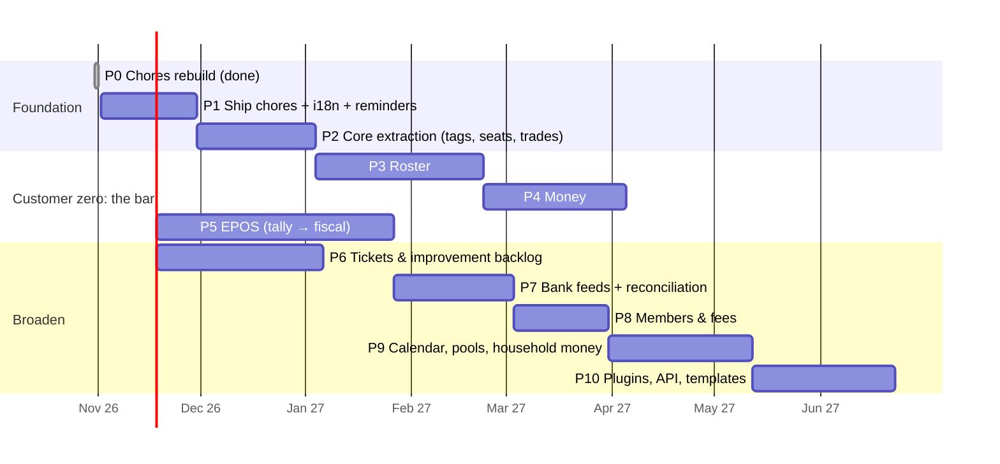

# 05 · Roadmap

Re-sequenced for the **semi-professional focus**, with the town bar as
customer zero. Sizes assume one developer part-time (~10 h/week). Each phase
ships something the bar or a household can use on its own, and has exit
criteria.

> **Regulatory clock.** Spain's VERI\*FACTU invoicing-software rules apply from
> **1 Jan 2027** (corporate-tax payers) / **1 Jul 2027** (others). A till that
> issues tickets in Spain must comply by then. On the timeline above, the
> fiscal part of P5 lands around mid-2027. That's tight, so P5 is split: a
> *non-fiscal tally* first (internal control and stock, alongside whatever
> issues legal tickets today), and *fiscal* either self-built or via a
> certified invoicing API. Confirm the association's exact obligation and
> date with its gestoría.

---

### P0 · Chores rebuild ✅
Nuxt 4 + Supabase. Recurrence, rotation/balancing, trades, households, invites,
fairness, SQL/unit/e2e tests.

### P1 · Ship chores (≈ 4 weeks)
Deploy (EU Supabase + static hosting). i18n en/es/pt. Daily digest + push for
trades. Away mode. Data export/delete. CI.
**Exit:** 2+ households using it for 2 weeks. CI green.

### P2 · Core extraction: the multi-person foundation (≈ 5 weeks)
- Monorepo with Nuxt layers. Move the schema to `core.*` / `work.*` (03 §10).
- **Member tags** (ROS-1), **selectors** and **requirements** (ROS-2, `work.requirements`).
- **Multi-seat items** (`work.item_assignees`).
- **Universal trades** with the `validate_assignment` hook (TRD-9..13). Chores
  keep working unchanged.
- `team` / `organisation` space kinds. Organisation roles via tags (treasurer, coordinator).
- Module manifest + per-space toggles. Brand and name decision.

**Exit:** chores runs as a layer. A test item with "needs ≥1 `plumber`" can only be traded to plumbers.

### P3 · Roster (≈ 7 weeks), for the bar
- Seasons, shift templates with requirements, policy (ROS-3, ROS-4).
- Generation, fair draw, understaffed handling, preview and publish (ROS-5..8, ROS-13).
  Port `docs/reference/rostering.ts` into `packages/domain` with its tests.
- Sign-up and sign-up-then-draw modes (ROS-9). Manual edits with live
  violations (ROS-10). Availability (ROS-11).
- Shift trades through the generic trade flow with valid-taker lists (TRD-10..12).
- Attendance + hours report (ROS-12). iCal feed of my shifts.
- Notifications: published rota, trade requests, understaffed alerts, day-before reminder.

**Exit:** the bar runs one full low-season month and one fiestas week on it.
Zero rule-breaking published shifts. Swaps happen in-app instead of on WhatsApp.

### P4 · Money: accounts (≈ 6 weeks), contabilify comes home
- `money.accounts` / `transactions`. Port contabilify's quick entry, transfers,
  recurring fee/interest engine and Excel import/export (FIN-11).
- Reimbursable expenses (a volunteer paid for lemons). Budgets per category (FIN-12).
- Migrate the bar's ledger (03 §10 step 4). Contabilify goes read-only.

**Exit:** the treasurer closes a month entirely in the platform. Totals match contabilify for the overlap period.

### P5 · EPOS (≈ 10 weeks, two stages)
- **5a · Tally (non-fiscal):** catalogue, member prices, tabs, offline orders,
  till sessions with cash count, close → accounts, stock + recipes + reorder
  purchases, reports (POS-1..7, POS-9, POS-10).
- **5b · Fiscal:** hash-chained records, the Spain adapter (QR, submission) or a
  certified-provider integration, compliance documentation (POS-8, NFR-10).
  Must be done **before** the applicable 2027 date for any Spanish user
  relying on it for legal tickets.

**Exit (5a):** the bar trades a full weekend offline-safe. Cash differences
per shift visible. **(5b):** compliance reviewed by a gestoría.

### P6 · Tickets & improvement backlog (≈ 7 weeks, can run in parallel after P4)
Hierarchy, workflows (Repair, Purchase, Improvement: Idea → Evaluating →
Approved → Budgeted → In progress → Done), materials and costs, `blocks` +
hand-offs, boards, waiting-for-budget, shopping list, assets, recurring
maintenance (TKT-1..11). Skill requirements on issues use the P2 rules.
**Exit:** the bar's broken tap and "second register for fiestas" live here, with costs.

### P7 · Bank feeds (≈ 5 weeks)
Provider evaluation for the bar's actual banks. Adapter + Vault + sync +
consent lifecycle + matching inbox (BNK-1..6).
**Exit:** 90%+ of a month's bank lines auto-matched or matched in one tap.

### P8 · Members & fees (≈ 4 weeks)
Register, fee plans, arrears, member QR for till pricing, assembly exports (MEM-1..4).

### P9 · Calendar, pools, household money (≈ 6 weeks)
Events, activities, term planner, upkeep pools (CAL-*). Household splits and
settle-up with simplification (FIN-1..10) for the free tier.

### P10 · Plugins, API, templates (≈ 6 weeks)
Personal access tokens, webhooks, template packs ("Community bar", "Festival
committee", "Maintenance crew", "Flatshare"), importers (PLG-*).

---

## Cross-cutting tracks
| Track | Practice |
|---|---|
| Testing | SQL suites per migration (outsider + happy path). Domain engines with unit + property tests (roster: random rule sets must never yield invalid teams). Playwright flow per feature. Offline till tests (kill/restore network mid-order). |
| Security | RLS checklist in PRs. Vault for secrets. Fiscal tables without UPDATE/DELETE grants. |
| Compliance | Keep a `docs/compliance/` log per jurisdiction (VERI\*FACTU, registro de jornada, GDPR). Review with a gestoría before selling EPOS. |
| Design | Separate till design language (touch, contrast). Every screen at 320 px and in dark mode. |

## Risks and mitigations
| Risk | Impact | Mitigation |
|---|---|---|
| Scope (now 9 modules) | Never finishes | Customer-zero discipline: only build what the bar or a household uses next month. Phase exits are real usage, not features. |
| Fiscal compliance effort and liability | Can't legally sell EPOS in Spain | Start non-fiscal. Evaluate a certified-API partner. Get a gestoría review. Treat 5b as a gate for selling, not for using internally. |
| Bank aggregator terms change | Feature breaks | Adapter pattern, CSV import fallback (always available). |
| Volunteers resist a new app | No adoption | Link-based PWA, ES/PT, PIN at the till, rota also visible as iCal and WhatsApp-shareable image. |
| One-developer bus factor | Project stalls | Open-source core, docs as they are now, tests as the spec. |
