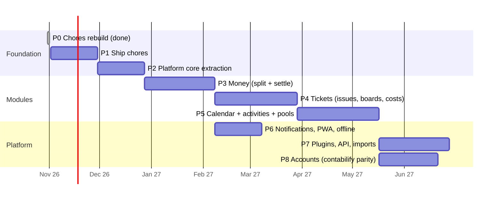

# 05 · Roadmap

Sizes assume one developer part-time (~10 h/week). "Exit criteria" are what
must be true to call a phase done. Each phase ships something usable. No
phase depends on a later one.

---

### P0 · Chores rebuild ✅ (this branch)
Nuxt 4 + Supabase, recurring chores, rotation/balanced assignment, trades,
households, invites, activity, fairness stats, SQL/unit/e2e tests.

### P1 · Ship chores (≈ 4 weeks)
**Goal:** you and your flatmates use it every day.
- Deploy: Supabase EU project, Vercel static deploy, auth redirect URLs, keep-alive cron.
- i18n en/es/pt (`@nuxtjs/i18n`). Locale and timezone in the profile (CORE-9, CORE-13).
- PWA manifest and installable icon. Basic offline shell.
- Daily digest email (Edge Function + pg_cron) and web push for trade requests (NTF-1..3, subset).
- Away / vacation mode (CORE-10).
- Account export and deletion (CORE-12).
- CI on GitHub Actions: typecheck, vitest, `test:db`, `test:e2e`.
- Polish from real use: bulk actions, a "what changed" view, an empty-state onboarding checklist.

**Exit:** 2+ households using it for 2 weeks. No data-loss bugs. CI green on every PR.

### P2 · Platform core extraction (≈ 4 weeks)
**Goal:** the second module can be built without touching the chores code.
- Monorepo (pnpm workspaces): `layers/core`, `layers/chores`, `packages/domain`, `apps/web`.
- Schema move to `core.*` / `work.*` with compatibility views (03 §10 steps 1–3).
  Rename chores→series, tasks→items. Add `number`, `rank`, `state_category`,
  `parent_id`, `item_links`, tags.
- Module manifest + `space_modules` toggles. Navigation and settings assembled from manifests.
- Generalised `core.events` + agenda provider interface.
- Settle the name and brand (02 §3). Rename the app shell.

**Exit:** chores runs as a layer. All tests pass unchanged. A stub "hello" module can be added in < 1 hour.

### P3 · Money (≈ 6 weeks)
**Goal:** replace Splitwise for the flat.
- Expenses with all split methods and contacts (FIN-1..4).
- Balances, pairwise view, **Settle up** with simplification (FIN-5..7).
- Multi-currency with fx snapshots (FIN-8).
- **Chore ↔ cost link:** "Add cost" on any item. "Ran out of X" creates a purchase for anyone (FIN-9, FIN-10).
- Import from Splitwise CSV.

**Exit:** a month of the flat's spending tracked. Balances match a hand-computed spreadsheet. Property tests for split and simplify.

### P4 · Tickets (≈ 7 weeks)
**Goal:** the door and the console live here, from symptom to receipt.
- Hierarchy, workflows (Simple, Repair, Purchase), custom states (TKT-1..3).
- Issue detail: notes, next action, diagnosis, materials, asset, history (TKT-4, TKT-7, TKT-10).
- `blocks` links, hand-off notifications (TKT-5). Material → purchase → expense (TKT-6).
- Boards: list / kanban / table with saved queries (TKT-8).
- Waiting-for-budget and shopping-list views (TKT-9).
- Recurring maintenance via series (TKT-11).

**Exit:** the toilet-seal scenario works end to end (02 §1). The kanban drag-and-drop is keyboard-accessible.

### P5 · Calendar, activities, pools (≈ 7 weeks)
**Goal:** time is part of the system, not a separate app.
- Week, day and month views. Events with RRULE. Time-boxing items by drag (CAL-1..3).
- Activities with weekly blocks and terms. Conflict detection (CAL-2, CAL-4).
- Term planner ported from `schedules` (CAL-5).
- **Pools + daily draws** (CAL-6..8). The "Upkeep" scenario.
- iCal export feed, import of external feeds (CAL-9).
- Unified "My day" agenda across modules (AGD-1..3).

**Exit:** a full semester planned. Upkeep draws in use for 2 weeks. The agenda replaces the Today page.

### P6 · Notifications, PWA, offline (≈ 4 weeks, parallel after P3)
- Full notification matrix and preferences, quiet hours (NTF).
- Offline read cache, queued writes, conflict handling.
- Capacitor wrapper for app stores, only if push on iOS PWAs proves insufficient.

### P7 · Plugins, API, imports (≈ 6 weeks)
- Personal access tokens, REST docs, webhooks (PLG-1..3).
- Template packs (PLG-4): "New flat starter", "Moving house", "Bike maintenance".
- Importers: Todoist, Trello, Google Calendar (via iCal), Splitwise (if not done in P3).
- First integration plugin as a reference (e.g. Home Assistant: a sensor event creates an item).

### P8 · Accounts, contabilify parity (≈ 5 weeks)
- `money.accounts` / `transactions`, the recurring fee/interest engine port, quick entry, Excel sync (FIN-11).
- Migrate "El Chiring" ledger. Contabilify becomes read-only, then retired.
- Budgets (FIN-12).

---

## Cross-cutting tracks (always on)

| Track | Practice |
|---|---|
| Testing | Every migration ships SQL tests (outsider + happy path). Every pure algorithm in `packages/domain` with unit and property tests. The Playwright smoke test grows one flow per feature. |
| Security | RLS review checklist in the PR template. Yearly dependency audit. No service key in the client. |
| Design | Token-based design system in the core. Every new screen checked at 320 px and in dark mode. |
| Docs | These docs stay current: requirement ids referenced in commits, status columns updated. |

## Risks and mitigations

| Risk | Impact | Mitigation |
|---|---|---|
| Scope creep (everything app) | Never ships | Phase gates with exit criteria. Each phase usable alone. Dogfood before adding. |
| Supabase free-tier pause and limits | Downtime | Keep-alive cron (as in contabilify). Paid tier once others depend on it (~$25/mo). |
| Model generalisation too early | Rewrites | P2 only generalises what chores already uses. Tickets and calendar extend it in their own phases. |
| Flatmates won't install another app | No network effect | PWA via link, no store needed. Guest role. Email digests work without opening the app. |
| Money correctness | Trust lost forever | Integer cents, property tests, immutable history, settlements confirmable. |
